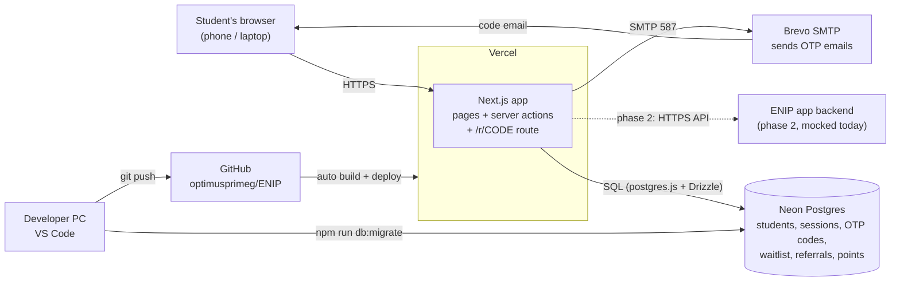
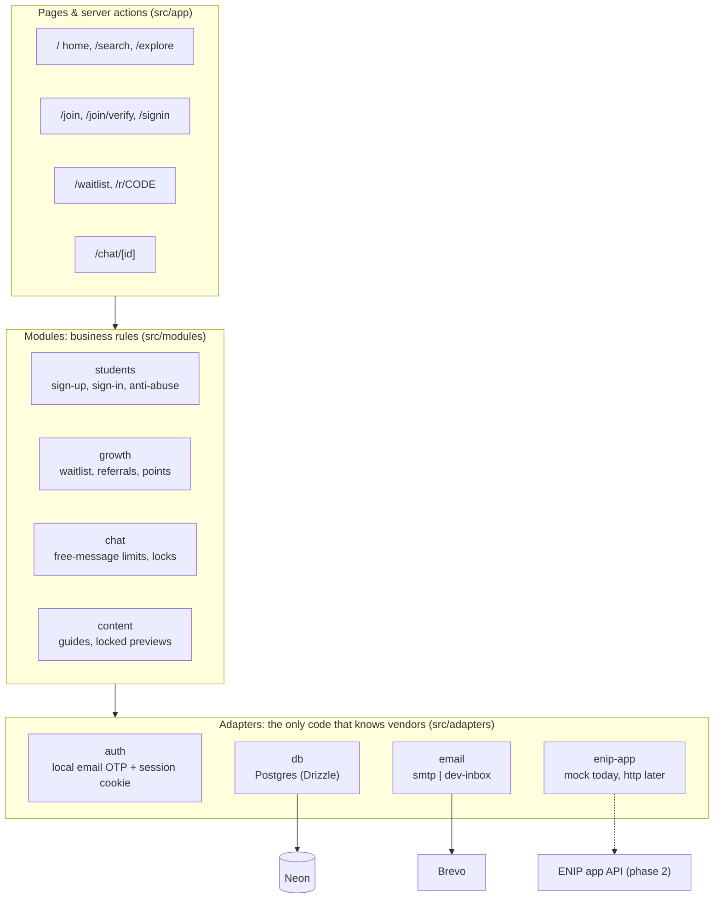
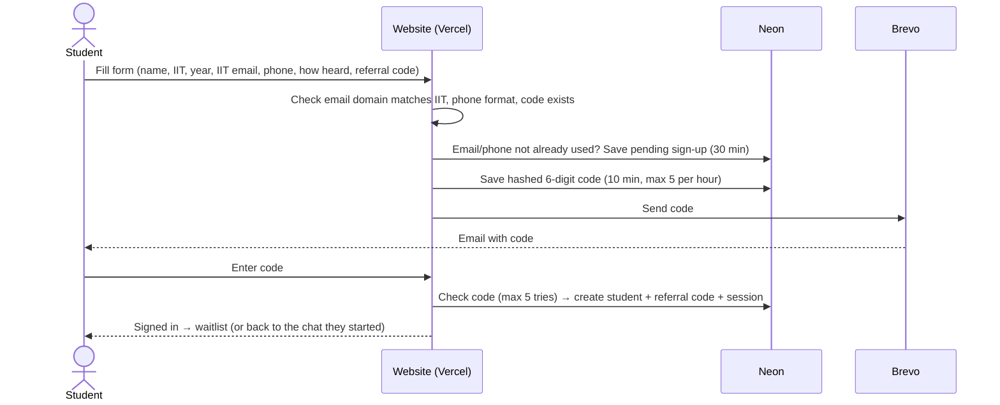
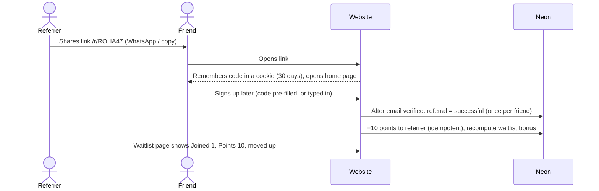
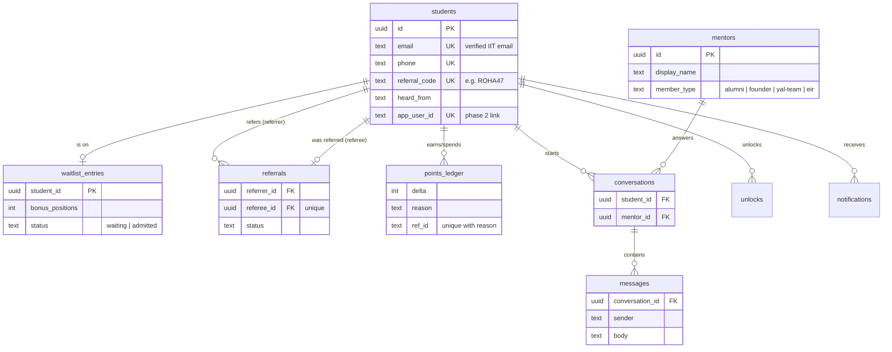

# ENIP Web: how it's built and deployed

A one-stop overview for anyone joining the project. Diagrams render on GitHub. For the planned connection to the ENIP app, see [INTEGRATION.md](./INTEGRATION.md).

## 1. What it is

**ENIP Web** is the student-facing website for ENIP (by YAL). 3rd/4th-year IIT students explore guides and seniors, verify their IIT email with a one-time code, chat with seniors, join a waitlist and refer friends to move up. It's a single **Next.js** app deployed on **Vercel**, with a **Neon Postgres** database and **Brevo** for email.

- Live site: `<fill in: https://….vercel.app or custom domain>`
- Code: <https://github.com/optimusprimeg/ENIP> (branch `main`)

## 2. Deployment



**How a change goes live:** commit → `git push` to `main` → Vercel builds and deploys automatically. Other branches get their own preview URL.
**Database changes are not automatic:** after changing `src/adapters/db/schema.ts`, run `npm run db:generate` and then `npm run db:migrate` against the target database, **before** pushing code that needs the new columns.

## 3. Tech stack

| Part       | Tool                                                                                    |
| ---------- | --------------------------------------------------------------------------------------- |
| Framework  | Next.js 16 (App Router, Cache Components, Partial Prefetching), React 19, TypeScript    |
| Styling    | Tailwind CSS 4 (design tokens in `src/app/globals.css`), Inter font, lucide-react icons |
| Validation | zod                                                                                     |
| Database   | Neon (Postgres) via Drizzle ORM + `postgres` driver; migrations in `drizzle/`           |
| Email      | Nodemailer over SMTP (Brevo now, company SMTP later)                                    |
| Hosting    | Vercel (auto-deploy from GitHub)                                                        |
| Quality    | ESLint, Prettier (`npm run check`)                                                      |

## 4. Code structure: three layers

Pages never talk to vendors directly. Each outside service sits behind one **adapter**, so it can be swapped by changing one file or an environment variable.



Product rules (points per referral, waitlist milestones, free chat limits) live in `src/config/rules.ts`; all URLs are built in `src/lib/routes.ts`.

## 5. Key flows

### Sign-up with IIT email code



### Referral



Waitlist milestones: 1 referral moves you up 3 places, 2 move you up 7, and 3 skip the line. One referral also unlocks full chat.

## 6. Database (Neon Postgres)



Also: `pending_sign_ups`, `otp_codes` and `sessions` (sign-in), plus `unlocks` and `notifications` (for upcoming features). Column details: [INTEGRATION.md §3](./INTEGRATION.md).

## 7. Configuration (environment variables)

Set in **Vercel → Project → Settings → Environment Variables** (production) and in `.env.local` (local, never committed). Values are secret and are not listed here.

| Variable                                                        | Purpose                                                 | Production value |
| --------------------------------------------------------------- | ------------------------------------------------------- | ---------------- |
| `DATABASE_URL`                                                  | Neon connection string (use the pooled one)             | secret           |
| `EMAIL_PROVIDER`                                                | `smtp` sends real email; `dev-inbox` only works locally | `smtp`           |
| `SMTP_HOST`, `SMTP_PORT`, `SMTP_USER`, `SMTP_PASS`, `SMTP_FROM` | Brevo SMTP login and verified sender                    | secret           |
| `SITE_URL`                                                      | Public address used in referral links                   | `<fill in>`      |
| `AUTH_PROVIDER`                                                 | Sign-in implementation                                  | `local`          |
| `ENIP_APP_PROVIDER`                                             | ENIP app connection                                     | `mock` (phase 1) |

After changing a variable in Vercel, **redeploy** for it to take effect.

## 8. What's real vs. placeholder today

| Area                                     | Status                                                                                                                                                                              |
| ---------------------------------------- | ----------------------------------------------------------------------------------------------------------------------------------------------------------------------------------- |
| Sign-up, IIT email code, sign-in/out     | Real (Neon + Brevo)                                                                                                                                                                 |
| Waitlist, referral links/codes, points   | Real (Neon)                                                                                                                                                                         |
| Guides, stories, stats, testimonials     | Sample content in code (`src/modules/content/sample-data.ts`)                                                                                                                       |
| Seniors list and search                  | Sample profiles (`src/adapters/enip-app/mock.ts`)                                                                                                                                   |
| Chat                                     | Mock replies kept in server memory: **not reliable on Vercel** (each server instance has its own memory). Moving to the `conversations`/`messages` tables + a `/team` inbox is next |
| WhatsApp alerts, admin portal, CV upload | Not built yet                                                                                                                                                                       |

## 9. Running it locally

```bash
npm install
npm run dev
```

Needs a `.env.local` (copy `.env.example`) with at least `DATABASE_URL`. With `EMAIL_PROVIDER=dev-inbox`, codes appear at `http://localhost:3000/dev/inbox` instead of being emailed. Checks before pushing: `npm run check` and `npm run build`.
